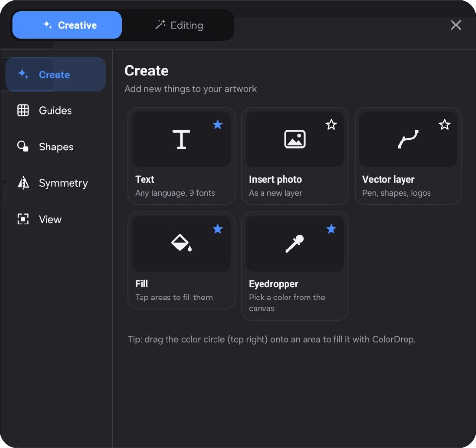
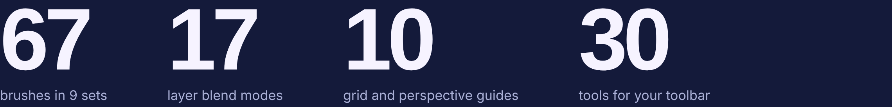

<p align="center">
  
</p>

<p align="center">
  <a href="https://dlwjan11-dot.github.io/Inkora/Inkora-0.10.2.apk"></a>
  &nbsp;
  <a href="https://dlwjan11-dot.github.io/Inkora/"></a>
</p>

<p align="center">
  
  
  
  
  
</p>

<p align="center">
  <a href="#english"><b>English</b></a> &nbsp;|&nbsp; <a href="#العربية"><b>العربية</b></a> &nbsp;|&nbsp; <a href="#کوردی"><b>کوردی</b></a>
</p>

---

<a id="english"></a>

## Inkora

**Inkora is a free drawing and painting app for Android tablets.** Nothing like Procreate existed on Android, so this is an attempt at one: pressure-sensitive brushes, layers, perspective grids, vector shapes for logos and comics, and a color wheel that opens right under your pen.

### Made by an artist, for artists

I'm Abdulrahman, a designer and artist. I looked for a long time for a drawing app on Android that feels like Procreate, and never found a good one, so I made Inkora. Before placing a single button I went through the art apps out there and took the best of each one. Everything in Inkora is where it is for a reason: the pen menu opens under your pen, the sliders sit by your other hand, and everything else stays out of the way of your drawing.

### New in 0.10: gestures, shortcuts and Procreate brush sets

- **Gesture controls**, like Procreate: choose what a touch, touch-and-hold, a three-finger swipe, a four-finger tap, a three-finger scrub, the S Pen button (click, double-click, hold), the pen held still, and the **□ modify button** do: eyedropper, smudge, erase, QuickShape, quick menu, full screen, clear layer, copy & paste, layer select. Plus rapid undo (hold two fingers), a quick pinch in to fit the canvas, one-finger panning and hover + finger for size and opacity.
- **Keyboard shortcuts** for a keyboard cover: Ctrl+Z / Ctrl+Shift+Z, Ctrl+C / X / V, B / N / E / M / S / V / F / T / U, `[` `]` for brush size, Ctrl+G grey view, R to turn the canvas, and more. Hold Ctrl to see them all.
- **A new Brush Library**: sets down the side with icons, big stroke previews, tap the brush in hand again for the Brush Studio. Imported Procreate sets keep their own name.
- **Actions panel** (the wrench): Add, Canvas, Share, Video, Prefs and Help in one place, with grey view, cut / copy / paste and a fixed toolbar-side setting.

<p align="center"></p>

### New in 0.8: a pro layout

<p align="center"></p>

| | |
|---|---|
| **1 · Top bar** | Gallery, menu, Creative and Editing on one side. Brush, smudge, eraser, layers and your color on the other. Tap the title to rename the artwork. |
| **2 · Your own toolbar** | Pick up to 14 of 30 tools: selection, transform, fill, text, filters, grids, symmetry, focus mode, export… Add, remove and reorder them. Left-handed? Swap the sides in one tap. |
| **3 · Size and opacity** | Two tall sliders by your other hand, with the eyedropper, undo and redo. |
| **4 · Creative and Editing** | Big visual panels: a preview of every grid and symmetry type, switches for QuickShape and assisted drawing, and adjustments previewed live on your own artwork. Tap ☆ on any card to add it to your toolbar. |

### The pen menu

<table>
<tr>
<td width="46%"></td>
<td>

Hold (or double-click) the S Pen button and everything is around your pen:

- a **standard color wheel** in the middle: hue ring plus saturation/brightness square, so a color is one move away
- your **saved colors** under it, and **+** to save the current one
- **tools** on top, **recent brushes** at the bottom
- **size** on the left arc, **opacity** on the right arc

Move over an item and release the button, or just tap it. Holding the pen tip still on the canvas opens the same menu.

| Pen | Does |
|---|---|
| Click | brush ⇄ eraser |
| Hold / double-click | quick menu |
| Draw, then pause | QuickShape: clean line, circle, box |
| Two / three-finger tap | undo / redo (hold to keep going) |
| Three-finger swipe down | cut, copy & paste |
| Four-finger tap | full screen |

Change any of them in **Actions › Prefs › Gesture controls**.

</td>
</tr>
</table>

### Everything a painting needs

<p align="center"></p>

- **Paint:** 120 brushes in 9 sets (inking, calligraphy with a Qalam nib for Arabic, sketching, painting, watercolor, airbrush, textures, effects, pixel art). Pressure and tilt, streamline, paper grain, and a Brush Studio to make your own. Import Procreate `.brush` / `.brushset` (or just open one with Inkora from your Files app: the set keeps its name, shape, grain, size and pressure), zip files, or brushes from a link.
- **Organize:** layers with 17 blend modes, alpha lock, merge, and panels you can pin over the canvas. Freehand, rectangle and ellipse selection with feathering. Transform, flip and rotate.
- **Guide:** square, dot, isometric, triangle, hexagon and polar grids, rule of thirds, and 1, 2 and 3-point perspective. Assisted drawing snaps strokes to the guide. Vertical, horizontal, quadrant and radial symmetry.
- **Make:** vector layers with a Bézier pen, shapes, gradients, boolean operations and SVG export. Text in any language (Arabic and Kurdish included). Adjustments and filters with live preview. Fill tool. Automatic time-lapse video. PNG, JPEG and `.inkora` project files.

### Install

1. Download **[Inkora-0.10.2.apk](https://dlwjan11-dot.github.io/Inkora/Inkora-0.10.2.apk)** on your Android device.
2. Open it. If Android asks, allow installs from this source.
3. If Play Protect warns you, tap **Install anyway** — Inkora isn't on Google Play yet.
4. Open Inkora and draw.

Made for big tablets with an S Pen (Galaxy Tab S series). Phones work too, with your finger.
SHA-256: `b5ddd57eb170f31c3eb3ac818a2f7dc78fb847cf98b37c28609bb9fbd94abfe9`

### Build it yourself

Open the folder in **Android Studio**, let Gradle sync, then press **Run ▶** with your tablet connected (Developer options → USB debugging on). Plain Kotlin and the Android framework, no external libraries.

```
app/src/main/java/com/abdulmedia/inkora/
  MainActivity.kt   layout, menus, dialogs        CanvasView.kt   drawing, gestures, S Pen
  StrokeEngine.kt   brush dabs, pressure, tilt    Brushes.kt      the 120 brush presets
  QuickMenuView.kt  pen menu                      ColorDisc.kt    standard color wheel
  ToolDock.kt       customizable toolbar          ToolsPanel.kt   Creative / Editing panel
  Vector*.kt        vector layers                 Guide*.kt       grids and perspective
```

Credits: the gesture-controls pages and the keyboard-shortcut list follow [ProCraft](https://github.com/artcraft-android/procraft) by artcraft-android (MIT OR Apache-2.0), rewritten for Inkora's own engine.

What's next: [ROADMAP.md](ROADMAP.md) (comics panels and speech bubbles, liquify, layer masks, PSD, animation).

---

<a id="العربية"></a>

<div dir="rtl">

## Inkora بالعربية

<p align="center"></p>

**Inkora تطبيق رسم وتلوين مجاني لأجهزة أندرويد اللوحية.** لم يكن على أندرويد تطبيق مثل Procreate، فهذه محاولة لصنعه: فُرَش تستجيب لضغط القلم، وطبقات، وشبكات منظور، وأشكال فيكتور للشعارات والقصص المصوّرة، ودولاب ألوان يفتح تحت قلمك مباشرة.

### من فنان، للفنانين
أنا عبد الرحمن، مصمم وفنان. بحثت طويلاً عن تطبيق رسم على أندرويد يشبه Procreate ولم أجد واحداً جيداً، فصنعت Inkora. جرّبت تطبيقات الرسم الموجودة وأخذت أفضل ما في كل واحد منها، وكل شيء في Inkora في مكانه لسبب.

### الجديد في 0.10
- **التحكم بالإيماءات** مثل Procreate: اختر ماذا يفعل اللمس والضغط المطوّل وسحب ثلاث أصابع ونقرة أربع أصابع وزر S Pen وزر □.
- **اختصارات لوحة المفاتيح**: اضغط Ctrl مطوّلاً لترى القائمة كلها.
- **مكتبة فُرَش جديدة**، وفُرَش Procreate تُفتح مباشرة من تطبيق الملفات وتحتفظ باسم مجموعتها.
- **لوحة الإجراءات** (المفتاح): إضافة، الرسمة، مشاركة، فيديو، التفضيلات، والمساعدة.

### الجديد في 0.8: واجهة احترافية
- **الشريط العلوي:** المعرض والقائمة وCreative وEditing في جهة، والفرشاة والتمويه والممحاة والطبقات واللون في الجهة الأخرى.
- **شريط أدواتك الخاص:** اختر حتى 14 أداة من 30، وأضفها واحذفها وغيّر ترتيبها. ووضع لليد اليسرى.
- **Creative وEditing:** لوحات كبيرة مصوّرة، ومعاينة مباشرة للتعديلات على رسمتك، ونجمة ☆ لإضافة أي أداة إلى شريطك.
- **قائمة القلم:** دولاب ألوان عادي في الوسط، وألوانك المحفوظة تحته، والأدوات في الأعلى، وآخر الفُرَش في الأسفل، والحجم يساراً والشفافية يميناً.
- **أداة تعبئة** و**وضع التركيز** الذي يخفي الواجهة.

### المزايا
- 120 فرشاة في 9 مجموعات، منها قلم قصب للخط العربي. استيراد فُرَش Procreate.
- طبقات مع 17 نمط دمج، وتحديد، وتحويل.
- 10 أنواع شبكات ومنظور، ورسم مساعد، وQuickShape، وتناظر.
- طبقات فيكتور، ونص بأي لغة، وفلاتر، وفيديو تايم لابس، وتصدير PNG وJPEG وSVG.

### التثبيت
1. حمّل **[Inkora-0.10.2.apk](https://dlwjan11-dot.github.io/Inkora/Inkora-0.10.2.apk)** على جهازك.
2. افتح الملف، واسمح بالتثبيت من هذا المصدر إذا طُلب منك.
3. إذا ظهر تحذير Play Protect اضغط **التثبيت على أي حال**.
4. افتح Inkora وابدأ الرسم.

</div>

---

<a id="کوردی"></a>

<div dir="rtl">

## Inkora بە کوردی

<p align="center"></p>

**Inkora ئەپێکی بێبەرامبەری وێنەکێشان و ڕەنگکردنە بۆ تابلێتەکانی ئەندرۆید.** فڵچەی هەستیار بە پەستانی قەڵەم، چینەکان، تۆڕی پێرسپێکتیڤ، شێوەی ڤێکتەر بۆ لۆگۆ و چیرۆکی وێنەدار، و چەرخێکی ڕەنگ کە ڕاستەوخۆ لە ژێر قەڵەمەکەتدا دەکرێتەوە.

### لە هونەرمەندێکەوە، بۆ هونەرمەندان
من عەبدولڕەحمانم، دیزاینەر و هونەرمەند. ماوەیەکی زۆر بەدوای ئەپێکی وێنەکێشاندا گەڕام لەسەر ئەندرۆید کە وەک Procreate بێت و هیچ یەکێکی باشم نەدۆزییەوە، بۆیە Inkoraم دروست کرد. ئەپەکانی وێنەکێشانم تاقی کردەوە و باشترینی هەر یەکێکیانم وەرگرت، و هەموو شتێک لە Inkora بە هۆیەکەوە لە شوێنی خۆیدایە.

### نوێ لە 0.10
- **کۆنترۆڵی جووڵەکان** وەک Procreate: هەڵبژێرە دەستلێدان، ڕاگرتن، ڕاکێشانی سێ پەنجە، کرتەی چوار پەنجە، دوگمەی S Pen و دوگمەی □ چی بکەن.
- **کورتبڕەکانی تەختەکلیل**: Ctrl ڕابگرە بۆ بینینی هەموویان.
- **کتێبخانەی نوێی فڵچەکان**، و فڵچەکانی Procreate ڕاستەوخۆ لە ئەپی فایلەکانەوە دەکرێنەوە.

### نوێ لە 0.8
- **شریتی سەرەوە:** گەلەری، مێنیو، Creative و Editing لە لایەک؛ فڵچە، سڕەرەوە، چینەکان و ڕەنگ لە لایەکەی تر.
- **شریتی ئامرازی خۆت:** تا ١٤ ئامراز لە ٣٠ هەڵبژێرە، زیادیان بکە، لایان ببە و ڕیزبەندییان بگۆڕە. دۆخی دەستەچەپیشی هەیە.
- **Creative و Editing:** پانێڵی گەورەی وێنەدار و پێشبینینی ڕاستەوخۆی ڕێکخستنەکان لەسەر کارەکەت.
- **مێنیوی قەڵەم:** چەرخی ڕەنگی ئاسایی لە ناوەڕاست، ڕەنگە پاشەکەوتکراوەکانت لە ژێریدا، ئامرازەکان لە سەرەوە، فڵچەکان لە خوارەوە، قەبارە لە چەپ و ناڕوونی لە ڕاست.

### دامەزراندن
1. **[Inkora-0.10.2.apk](https://dlwjan11-dot.github.io/Inkora/Inkora-0.10.2.apk)** لەسەر ئامێرەکەت دابگرە.
2. فایلەکە بکەرەوە و ئەگەر پرسیاری کرد، ڕێگە بە دامەزراندن لەم سەرچاوەیە بدە.
3. ئەگەر Play Protect ئاگاداریی پیشان دا، کرتە لە **Install anyway** بکە.
4. Inkora بکەرەوە و دەست بە وێنەکێشان بکە.

</div>

---

<p align="center">
  Made by <a href="https://abdulmedia.com"><b>Abdulmedia</b></a> &nbsp;|&nbsp; <a href="https://dlwjan11-dot.github.io/Inkora/">dlwjan11-dot.github.io/Inkora</a>
</p>
