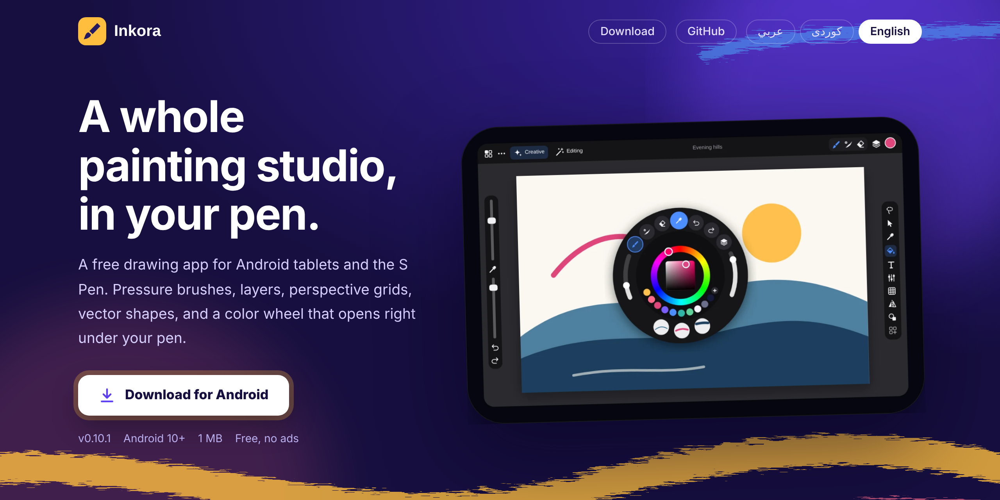
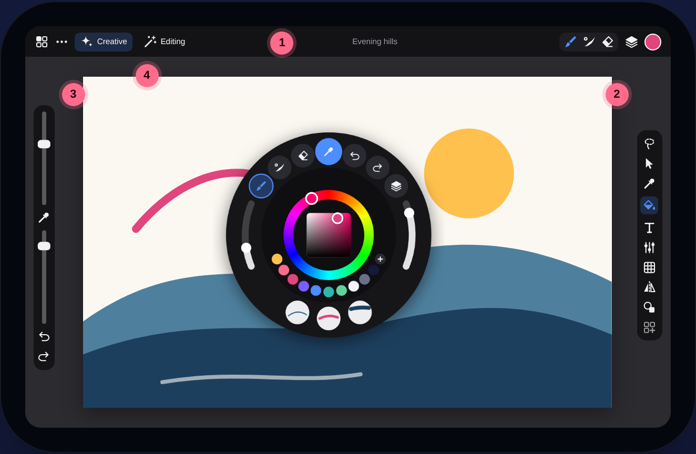
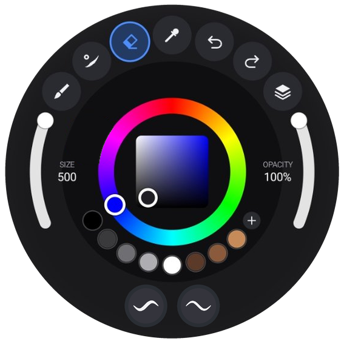
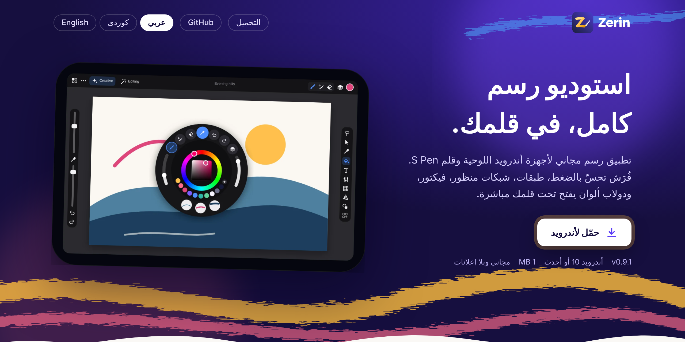
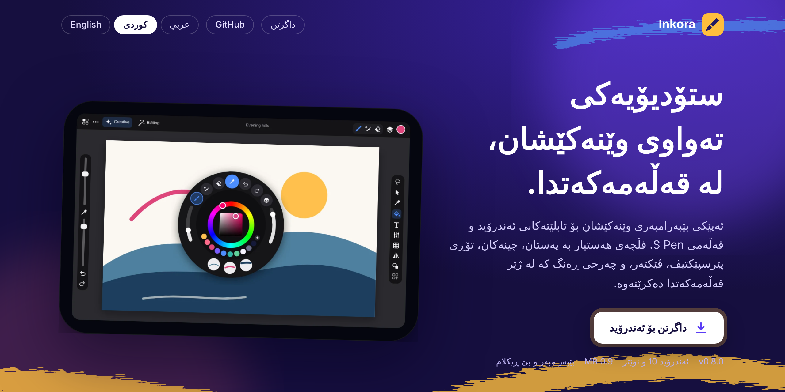

<p align="center">
  
</p>

<p align="center">
  <a href="https://dlwjan11-dot.github.io/Inkora/Inkora-0.37.1.apk"></a>
  &nbsp;
  <a href="https://dlwjan11-dot.github.io/Inkora/"></a>
</p>

<p align="center">
  
  
  
  
  
</p>

<p align="center">
  <a href="#english"><b>English</b></a> &nbsp;|&nbsp; <a href="#العربية"><b>العربية</b></a> &nbsp;|&nbsp; <a href="#کوردی"><b>کوردی</b></a>
</p>

---

<a id="english"></a>

## Inkora

**Inkora is a free drawing and painting app for Android tablets.** Nothing like Procreate existed on Android, so this is an attempt at one: pressure-sensitive brushes, layers and masks, perspective and fisheye grids, vector shapes for logos and comics, posable 3D figures, and a color wheel that opens right under your pen.

Plain Kotlin on the Android framework, with no outside libraries; every line of code and every icon is drawn for Inkora.

> **Trademark note:** "Procreate" is a registered trademark of Savage Interactive. Inkora is an independent app with its own name, design and code, and is not affiliated with or endorsed by Savage Interactive or any other company.

### Made by an artist, for artists

I'm a designer and artist. I looked for a long time for a drawing app on Android that feels like Procreate, and never found a good one, so I made Inkora. Before placing a single button I went through the art apps out there and took the best of each one. Everything in Inkora is where it is for a reason: the pen menu opens under your pen, the sliders sit by your other hand, and everything else stays out of the way of your drawing.

## Get Inkora

| Platform | File | Install |
|---|---|---|
| Android 10+ tablets and phones | [`Inkora-0.37.1.apk`](https://dlwjan11-dot.github.io/Inkora/Inkora-0.37.1.apk) (0.37.1, everything included: Living Paint brushes too) | Open it, allow installs from this source once, tap **Install anyway** if Play Protect asks |
| iPad and iPhone | the `ios/` folder (Xcode project, version 1.0) | Open `ios/Inkora.xcodeproj` on a Mac, pick your team, press **Run ▶**; see `ios/README.md` |
| Android Studio | this repository (source is at **0.37.1**) | Open the folder, let Gradle sync, press **Run ▶** with your tablet connected |

Made for big tablets with an S Pen (Galaxy Tab S series). Phones work too (the layout slims down for them, upright or on the side), with a finger or the S Pen of an Ultra. Inkora is not on Google Play yet.
SHA-256 of the 0.37.1 APK: `b1142596efa1e0db30de2875abcff3f121cb30ddf7fccf7573e7933c2cb15c43`

## New in 0.25: a new way around the app

- **Tool bar** on the left or right, like desktop painting programs: every tool always visible. A small corner triangle means sister tools: hold it (or tap it again) to pick one. Tap the brush, smudge or eraser again for the brush library.
- **»** opens it wide with every tool named; the **floating** button hides the bars and keeps only your tools in a small bar you drag anywhere; **⋯** adds tools, takes them out and changes the order.
- **One settings bar** under the top bar for the tool in hand (brush, size, opacity; selection modes; shapes; Apply and Cancel), in place of the bars that used to float at the bottom.
- **0.25.1**: every tool bar has **Cancel** next to Done (takes back all the tool did); a finger down (or the S Pen button held) while drawing a shape makes it even, and free again when let go; your last eraser stays for next time (Settings); Fill and ColorDrop can **close gaps** in lines that do not quite meet (Settings › Fill and ColorDrop); drag sideways on Size or Opacity in the settings bar to change them; messages no longer hide behind the bars.
- **Top bar**: Actions, Add, Adjust, Canvas on the left; Brushes, Layers, Color on the right. Every panel opens right under its button with a small arrow, and the same button closes it. On a phone the panels come up from the bottom and the tools sit along the bottom.

## New in 0.24: tidier menus and new icons

- **Toolbar**: put it on the left or right (or top / bottom); ⊞ opens it wide with every tool, grouped and named (hold one to make it a favorite); « tucks it into a small tab on the edge.
- **Creative and Editing**: a new Color section, tools as clear rows with what they do, chips on phones; the ••• menu shows both with their sections.
- **Pop-up menus** everywhere (layers, brushes, palettes, gallery…) now match Inkora's dark or light look, with icons.
- **Actions**: icons on every row and the settings sorted into Interface, Layout, Painting, and Pen and touch.
- A distinct icon for every tool (gradient, recolor, measure, crop, liquify, comics…).

## New in 0.23: the gestures pros use

- **Transform**: pull a side to stretch along the shape; the yellow dot turns the box alone; tap the green dot for an exact angle or a corner for an exact size; the piece snaps to the canvas center and edges and to what is on other layers.
- **Layers**: hold a checkbox to see that layer alone; two fingers tap a layer for its opacity, swipe it for Alpha Lock; pinch layers together to merge them; copy a layer into another artwork.
- **QuickShape**: put a finger down while holding a shape and it becomes a perfect circle, square or even polygon.
- **Color**: hold the color circle for the previous color; double-tap the wheel for pure hues; **Recolor** tool: tap an area and it follows every color you try.
- **Gallery**: pinch an artwork (or Preview in its menu) to see it big and swipe through them.
- **Shapes** on drawing layers: rectangle, ellipse, triangle, star, hexagon, heart, line and arrow, drawn with your brush or filled.
- Selection mask visibility, and a **light interface** (Preferences).

## New in 0.22: measure, palettes from photos, backups

- **Measure**: drag across the canvas for the length (px, cm or inches at 300 dpi) and the angle; it catches on 0°, 15°, 45°, 90°. Turn the line into a **ruler** your strokes follow, or draw it with the brush in hand.
- **Palette from a photo**: Inkora finds the main colors; choose how many, take some out, tap the photo to add any spot. Works on your own artwork too.
- **Back up all artworks** into one file (save it on Google Drive or a computer) and restore it on any device. Restoring never removes what is already there.
- Adjustments (hue, saturation, brightness, contrast, color balance) now follow the slider at once, even on big canvases; blur and sharpen show a quick preview while you drag.
- The website APK now has the **Living Paint** brushes too.

## New in 0.19 – 0.21: watercolor, comics, snapshots, phones

**Painting**
- **Aquarelle**: watercolor that looks like it while you draw. Pigment catches in the paper (granulation), pools at the rim of the stroke (wet edge), and a stroke over paint that is still wet **runs softly into it**. New sets beside it: Tempera, Markers, Light & Shade.
- **Gradient** tool: linear or radial, from your color into another or fading out; it respects selections and alpha lock.
- **Comics**: panel layouts for a page (space, line and margin to taste) and speech, thought, shout and caption bubbles you place like any layer.

**Working**
- **Snapshots**: keep the artwork as it is now and come back to it later (the newest twelve are kept).
- The **reference photo** you import stays with its artwork.
- **Brush library**: Pinned and Recent at the top; slide a brush left to pin, find, duplicate or reset it. Hold Eraser or Smudge and it takes the brush you are painting with.
- **Layers**: drag a layer by its grip to reorder it; a line shows where it lands.
- **Sliders**: slide away from the bar for fine control, double-tap the handle to leave a mark you can tap to come back to (each brush keeps its own), hold the handle to type an exact number.
- The quick menu changes brushes too.

**Learning it**
- A **tour** on first start, a **Guide** page, and **Shortcuts, shown**: every gesture as a small moving picture (also [on the website](https://dlwjan11-dot.github.io/Inkora/#shortcuts)).
- Rest the pen over any button for two seconds and it says what it does.

**Phones**: the top bar, the sliders, the panels and the gallery fit a phone screen, upright or on its side.

## New in 0.18: living paint

Inkora now has a second brush engine: **MyPaint** (the open-source libmypaint, built into the app as native code). Brushes in the new **Living Paint** set paint with it, and the paint stays alive while you draw:

- colors **mix like real pigment** (blue into yellow turns green, not grey), and a brush **picks up and carries** the paint it passes over
- **Wet Blender** pushes paint around without adding any
- strokes **swell with pressure and thin out when you move fast**, charcoal and pastel **break up** on the paper
- 12 brushes, all designed for Inkora: Rain Wash, Creamy Gouache, Loaded Oil, Wet Blender, Living Ink, Raw Charcoal, Chalk Pastel, Soft Graphite, Dry Bristle, Mist Spray, Felt Marker, Flick Spatter
- they work with undo, symmetry (also kaleidoscope), selections, alpha lock, layer masks and the eraser. Change size and opacity on the side bar.

The brush files are in `app/src/main/assets/living/`; `tools/living-brushes/` has the script that makes them and a test program that paints a sample sheet with each one.

## New in 0.14: masks, liquify, magic wand, canvas size, fisheye

- **Layer masks**: Layers › a layer › *Add layer mask*. Erase on the mask to hide parts of the layer, paint to bring them back. *Invert mask*, *Show all* and *Apply mask* are in the mask's options.
- **Reference layer for coloring**: mark your line art as *Reference*, then Fill and ColorDrop on any other layer stop at its lines.
- **Selections**: **Magic wand** (tap an area), **Color range** (tap a color, get it everywhere) and a **Selection brush**, with **New / Add / Subtract** for every selection tool and a tolerance setting.
- **Liquify** (Editing › Transform): Push, Twirl both ways, Pinch, Bloat and Reconstruct, with size and strength. One undo step when you press Done.
- **Canvas size & crop** (Editing › Transform): change the canvas size with an anchor (crop or add space), resize the image, crop to a selection, rotate 90° and flip the whole canvas. Vector and 3D layers stay sharp.
- **Fisheye perspective**: curved horizontals and verticals with depth lines from the center; drag the center and the edge point. Assisted drawing follows the curves.
- **Ruler** and **Ellipse guide**: place them with their points; strokes run along the ruler (or parallel to it) and around the ellipse (or a bigger or smaller copy).
- **Kaleidoscope symmetry** with 3 to 16 slices, each stroke turned and mirrored.

<details>
<summary><b>Earlier versions (0.8 – 0.13)</b></summary>

#### New in 0.13: 3D & poses, shadow layers, your own palettes

- **3D & poses** (Creative › Create): a posable figure with 14 ready poses (walking, running, sitting, kneeling, fighting, lying down…). Tap a body part to bend, twist or move it sideways, and mirror a pose to the other side. Add cubes, spheres, cylinders, cones, stairs, arches and walls, or import your own `.obj` / `.stl` models. Turn the camera with one finger, zoom and move with two, set the lens, the light and the look (shaded, toon or lines), then place the scene as a 3D layer. Open it again later from Layers › Edit 3D scene.
- **Shadow layers**: a layer you see while you draw, but that stays out of the time-lapse, exports and thumbnails. Use **Shadow photo** to trace a picture without it showing in your time-lapse, or switch any layer to Shadow in its options. 3D layers are shadow layers unless you turn it off.
- **Your own palettes**: make, name, switch and delete palettes in the color panel, add the current color with one tap, long-press a color to remove it, or build a palette from your artwork or a photo. The active palette shows in the pen's quick menu.
- **Hue, Saturation and Brightness sliders** in the color panel.
- **Actual size**: Creative › View shows the canvas at 100%. A quick, short pinch in still fits it to the screen.

#### New in 0.12: layer groups and picking several layers

- **Pick several layers**: swipe a layer to the right in the Layers panel. Then group, merge or delete them together, or use Transform to move, scale and rotate them all at once.
- **Layer groups**: a group has its own visibility, opacity and blend mode (Normal is "Pass Through"). Tap the arrow to fold it; tap the group to select all of it, tap again for its options: rename, duplicate, merge, ungroup, move, delete. Moving a layer past the edge of a group takes it out; moving it next to a group puts it in.
- Groups are kept in `.inkora` projects and in Photoshop files, both ways.

#### New in 0.11: Brush Studio, Photoshop files, stacks

- **A full Brush Studio** (tap the brush in hand again): stroke path, stabilization and motion filtering, taper, shape (rotation, roundness, flips), grain (scale, depth), rendering (flow, blend mode), **wet mix** (dilution, charge, pull), **color dynamics** (per dab, per stroke, with pressure and tilt), dynamics, and the **dual brush**. A drawing pad redraws your strokes as you move any setting. Your changes are kept for each brush.
- **Make and share brushes**: duplicate any brush into "My Brushes", change its shape and grain images, rename it, and export it as a `.brush`, or a whole set as a `.brushset`, in Procreate's file format. Imported Procreate brushes now keep their wet mix, color dynamics, stabilization, roundness, grain depth and dual brush.
- **Photoshop files**: open and save `.psd` with layers, names, opacity, blend modes, visibility, alpha lock and clipping masks. Export **PDF** and **TIFF**.
- **Stacks** in the gallery: long-press an artwork › Move to stack.

#### New in 0.10: gestures, shortcuts and Procreate brush sets

- **Gesture controls**, like Procreate: choose what a touch, touch-and-hold, a three-finger swipe, a four-finger tap, a three-finger scrub, the S Pen button (click, double-click, hold), the pen held still, and the **□ modify button** do: eyedropper, smudge, erase, QuickShape, quick menu, full screen, clear layer, copy & paste, layer select. Plus rapid undo (hold two fingers), a quick pinch in to fit the canvas, one-finger panning and hover + finger for size and opacity.
- **Keyboard shortcuts** for a keyboard cover: Ctrl+Z / Ctrl+Shift+Z, Ctrl+C / X / V, B / N / E / M / S / V / F / T / U, `[` `]` for brush size, Ctrl+G grey view, R to turn the canvas, and more. Hold Ctrl to see them all.
- **A new Brush Library**: sets down the side with icons, big stroke previews, tap the brush in hand again for the Brush Studio. Imported Procreate sets keep their own name.
- **Actions panel** (the wrench): Add, Canvas, Share, Video, Prefs and Help in one place, with grey view, cut / copy / paste and a fixed toolbar-side setting.


</details>

## The layout

<p align="center"></p>

| | |
|---|---|
| **1 · Top bar** | Gallery, menu, Creative and Editing on one side. Brush, smudge, eraser, layers and your color on the other. Tap the title to rename the artwork. |
| **2 · Your own toolbar** | Pick up to 14 of 30 tools: selection, transform, fill, text, filters, grids, symmetry, focus mode, export… Add, remove and reorder them. Left-handed? Swap the sides in one tap. |
| **3 · Size and opacity** | Two tall sliders by your other hand, with the eyedropper, undo and redo. |
| **4 · Creative and Editing** | Big visual panels: a preview of every grid and symmetry type, switches for QuickShape and assisted drawing, and adjustments previewed live on your own artwork. Tap ☆ on any card to add it to your toolbar. |

## The pen menu

<table>
<tr>
<td width="46%"></td>
<td>

Hold (or double-click) the S Pen button and everything is around your pen:

- a **standard color wheel** in the middle: hue ring plus saturation/brightness square, so a color is one move away
- your **saved colors** under it, and **+** to save the current one
- **tools** on top, **recent brushes** at the bottom
- **size** on the left arc, **opacity** on the right arc

Move over an item and release the button, or just tap it. Holding the pen tip still on the canvas opens the same menu.

| Pen | Does |
|---|---|
| Click | brush ⇄ eraser |
| Hold / double-click | quick menu |
| Draw, then pause | QuickShape: clean line, circle, box |
| Two / three-finger tap | undo / redo (hold to keep going) |
| Three-finger swipe down | cut, copy & paste |
| Four-finger tap | full screen |

Change any of them in **Actions › Prefs › Gesture controls**.

</td>
</tr>
</table>

## Big canvases, layers and memory

Every layer is one full picture the size of the canvas, kept in the tablet's memory. Inkora gives all layers together a quarter of the device's RAM (at least 600 MB, at most 4 GB) and shows the limit when you reach it. A canvas can have up to 25 megapixels.

| Canvas | Pixels | One layer | Layers on a 12 GB tablet |
|---|---|---|---|
| Full HD | 1920 × 1080 | ~8 MB | 200 (the cap) |
| Galaxy Tab S11 Ultra screen | 2960 × 1848 | ~22 MB | ~137 |
| 4K | 3840 × 2160 | ~33 MB | ~90 |
| A4 at 300 dpi | 2480 × 3508 | ~35 MB | ~86 |
| Square, 5000 px | 5000 × 5000 | ~100 MB | ~30 |

- Undo stores only the part of a layer that a stroke changed.
- Whole-canvas changes (canvas size, resize, rotate) build a new canvas next to the old one, so they need room for a second copy for a moment; when memory runs out Inkora says so and leaves the artwork as it was. These changes start a new undo history.
- 3D layers and vector layers are drawn again at the new size, so they stay sharp.

## Feature status

**Painting**
- [x] 219 brushes in 24 sets, including 12 living brushes on the MyPaint engine (real pigment mixing), pressure and tilt, streamline, paper grain, dual brush, wet mix, color dynamics
- [x] Brush Studio with a live drawing pad; make, rename and export your own brushes
- [x] Procreate `.brush` / `.brushset` import and export, zip files, brushes from a link
- [x] Smudge, eraser, Fill and ColorDrop with tolerance, eyedropper with a loupe
- [x] QuickShape: hold at the end of a stroke for a clean line, circle, rectangle or triangle

**Layers**
- [x] 17 blend modes, opacity, alpha lock, clipping masks, **layer masks**
- [x] Groups with their own opacity and blend mode, pick several layers with a swipe
- [x] Shadow layers (shown while you draw, left out of exports and the time-lapse)
- [x] Reference layers for Fill and ColorDrop
- [x] Vector layers: Bézier pen, shapes, gradients, boolean operations, SVG export
- [x] 3D layers: posable figure with 14 poses, 10 shapes, `.obj` / `.stl` models, camera, light, three looks

**Selecting and editing**
- [x] Freehand, rectangle, ellipse, magic wand, color range, selection brush; new / add / subtract; feather
- [x] Transform (move, scale, rotate, flip) for one or several layers
- [x] Liquify: push, twirl, pinch, bloat, reconstruct
- [x] Adjustments with live preview: hue/saturation/brightness, brightness/contrast, color balance, posterize, invert, black & white, blur, sharpen, noise
- [x] Canvas size with anchor, resize, crop to selection, rotate 90°, flip

**Guides**
- [x] Square, dot, isometric, triangle, hexagon and polar grids, rule of thirds, circle ruler
- [x] 1, 2 and 3-point perspective, fisheye perspective, ruler, ellipse guide
- [x] Assisted drawing on every guide
- [x] Symmetry: vertical, horizontal, quadrant, radial 8 / 12 / 16, kaleidoscope 3–16

**Color**
- [x] Pen quick menu with a color wheel under the pen, spinning swatch wheel, harmonies
- [x] Hue / saturation / brightness sliders, hex, recent colors
- [x] Your own palettes, palettes from your artwork or a photo

**Files and the rest**
- [x] Gallery with thumbnails and stacks, autosave
- [x] `.inkora` projects, Photoshop `.psd` (layers, groups, masks applied), PNG, JPEG, PDF, TIFF, SVG
- [x] Time-lapse recording and MP4 export
- [x] Gesture controls, keyboard shortcuts, customizable toolbar, left-handed layout
- [x] Floating reference image, navigator and lighting orb
- [x] English, Arabic and Sorani Kurdish, right-to-left layouts

**Next** (see [ROADMAP.md](ROADMAP.md))
- [ ] Warp and distort (corner pins and mesh)
- [ ] Curves and levels, gradient fill and gradient map
- [ ] Editable text layers
- [ ] Comic pages: panel templates and speech balloons
- [ ] Animation with onion skin and GIF / MP4 export
- [ ] GPU drawing for very big brushes and canvases

## Build it yourself

Open the folder in **Android Studio**, let Gradle sync, then press **Run ▶** with your tablet connected (Developer options → USB debugging on). Android Studio may update the Gradle and plugin versions for you; that is fine.

Since 0.18 Inkora has a native part (the brush engine, in C). Android Studio needs the **NDK** and **CMake** for it: *Tools › SDK Manager › SDK Tools*, tick **NDK (Side by side)** and **CMake**, press **Apply**. Android Studio usually offers to install them by itself on the first sync.

## Project layout

```
app/src/main/java/com/abdulmedia/inkora/
  MainActivity.kt    layout, menus, dialogs           CanvasView.kt     drawing, gestures, S Pen, liquify
  StrokeEngine.kt    brush dabs, pressure, symmetry   Brushes.kt        the 207 brush presets
  BrushStudio.kt     brush settings page               BrushImport.kt    Procreate brush files
  Document.kt        layers, groups, masks, drawing   History.kt        undo and redo
  Selection.kt       selections, magic wand            Liquify.kt        liquify mesh
  CanvasOps.kt       canvas size, crop, rotate         Adjustments.kt    filters and adjustments
  Guide*.kt          grids, perspective, fisheye       Vector*.kt        vector layers
  Scene3D*.kt        3D renderer, figures, editor      Palettes.kt       palettes, HSB sliders
  QuickMenuView.kt   pen menu                          ColorDisc.kt      color wheel
  ToolDock.kt        customizable toolbar              ToolsPanel.kt     Creative / Editing panel
  ProjectIO.kt       .inkora files                     PsdIO.kt          Photoshop files
  L10n.kt            English, Arabic, Kurdish          TimeLapse.kt      recording and video
  MyPaintNative.kt   living brushes (MyPaint engine)
app/src/main/cpp/    the MyPaint engine (libmypaint), json-c, and Inkora's bridge to them
app/src/main/assets/living/   the living brushes' settings
```

Credits: the living brushes run on [libmypaint](https://github.com/mypaint/libmypaint) by Martin Renold and the MyPaint contributors (ISC license), which uses [json-c](https://github.com/json-c/json-c) (MIT license); their license texts are in the app under Actions › Help › Open-source licenses. The gesture-controls pages and the keyboard-shortcut list follow [ProCraft](https://github.com/artcraft-android/procraft) by artcraft-android (MIT OR Apache-2.0), rewritten for Inkora's own engine.

---

<a id="العربية"></a>

<div dir="rtl">

## Inkora بالعربية

<p align="center"></p>

**Inkora تطبيق رسم وتلوين مجاني لأجهزة أندرويد اللوحية.** لم يكن على أندرويد تطبيق مثل Procreate، فهذه محاولة لصنعه: فُرَش تستجيب لضغط القلم، وطبقات، وشبكات منظور، وأشكال فيكتور للشعارات والقصص المصوّرة، ودولاب ألوان يفتح تحت قلمك مباشرة.

### من فنان، للفنانين
أنا مصمم وفنان. بحثت طويلاً عن تطبيق رسم على أندرويد يشبه Procreate ولم أجد واحداً جيداً، فصنعت Inkora. جرّبت تطبيقات الرسم الموجودة وأخذت أفضل ما في كل واحد منها، وكل شيء في Inkora في مكانه لسبب.

### الجديد في 0.25
- **شريط أدوات** يمين أو يسار متل برامج الكمبيوتر، كل الأدوات مبيّنة، والأدوات الأخوات بمسكة.
- **»** بيعرّضه بأسماء الأدوات، **العائم** بيخبّي الأشرطة وبيخلّي أدواتك بشريط صغير، و**⋯** للإضافة والشيل والترتيب.
- **شريط إعدادات واحد** فوق للأداة يلي بإيدك.
- **الشريط الفوقاني**: Actions و Add و Adjust و Canvas، و Brushes و Layers و Color. كل لوحة بتفتح تحت زرها.

### الجديد في 0.24
- **شريط الأدوات**: يمين أو يسار (أو فوق وتحت)، ⊞ بيفتحه عريض بكل الأدوات، و« بيخبّيه بلسان صغير.
- **Creative و Editing** أوضح، مع قسم جديد للألوان.
- كل **القوائم المنبثقة** صارت بنفس ستايل البرنامج مع أيقونات.
- **Actions**: أيقونة لكل سطر، والإعدادات مرتبة بأقسام.
- أيقونة خاصة لكل أداة.

### الجديد في 0.23
- **التحويل**: مطّ من الأطراف، النقطة الصفرا بتدوّر الإطار لحاله، كبسة على النقطة الخضرا لزاوية دقيقة وعلى الزاوية لحجم دقيق، ومحاذاة لنص اللوحة وأطرافها وللرسم بالطبقات التانية.
- **الطبقات**: مسك مربع الطبقة لتشوفها لحالها، إصبعين للشفافية أو لقفل الشفافية، قرص الطبقات لدمجها، ونسخ طبقة لرسمة تانية.
- **QuickShape**: إصبع عالشاشة بيخلّي الشكل دائرة أو مربع كامل.
- **الألوان**: مسك دائرة اللون للون يلي قبل، كبستين عالدائرة للون الصافي، وأداة **إعادة التلوين**.
- **المعرض**: اقرص الرسمة لتشوفها كبيرة وتنقّل بينهم بالسحب.
- وضوح قناع التحديد، و**واجهة فاتحة**.

### الجديد في 0.22
- **قياس**: اسحب على اللوحة لتعرف الطول (بيكسل أو سم أو إنش) والزاوية، وبيلزق على 0° و45° و90°. وبتقدر تحوّل الخط **لمسطرة** أو ترسمه بفرشاتك.
- **لوحة ألوان من صورة**: بيلاقي الألوان الأساسية، بتختار العدد، وبتشيل أو تضيف ألوان بكبسة.
- **نسخة احتياطية لكل الرسمات** بملف واحد (احفظه على Google Drive) واسترجعه على أي جهاز.
- التعديلات (اللون، التشبع، السطوع) صارت تمشي مع السلايدر فوراً حتى على اللوحات الكبيرة.
- ملف الموقع صار فيه فرش **الألوان الحيّة** كمان.

### الجديد في 0.19 – 0.21
- **ألوان مائية بروح المائي**: مجموعة Aquarelle، الصبغة بتعلق بحبيبات الورق وبتتجمع على طرف الضربة وإنت عم ترسم، وضربة فوق لون لسا مبلول **بتسيح فيه**. ومجموعات جديدة: Tempera و Markers و Light & Shade.
- **تدرّج لوني** خطّي أو دائري، و**كوميكس**: إطارات جاهزة للصفحة وفقاعات كلام وتفكير وصراخ.
- **لقطات محفوظة (Snapshots)**: احفظ الرسمة متل ما هي وارجعلها بعدين. و**صورة المرجع** بتضل مع رسمتها.
- **مكتبة الفرش**: المثبّتة والأخيرة فوق؛ اسحب الفرشاة لليسار للتثبيت والنسخ والإرجاع. اكبس مطوّل على الممحاة أو التمويه لتاخد نفس فرشاتك.
- **الطبقات**: اسحب الطبقة من مسكتها لترتّبها. **السلايدرات**: ابعد عن الشريط للتحكم الدقيق، كبستين على المسكة لعلامة، وكبسة طويلة لرقم دقيق.
- **جولة تعليمية** أول مرة، وصفحة **الاختصارات بالصور** (كل إيماءة بصورة متحركة)، ووقّف القلم فوق أي زر لثانيتين ليشرحلك شو بيعمل.
- **بيشتغل عالموبايل**: الواجهة بتتزبط لحالها بالطول وبالعرض.

### الجديد في 0.18: ألوان حيّة
- محرك فراشي تاني جوّا Inkora: **MyPaint** (مفتوح المصدر). فراشي مجموعة **ألوان حيّة** بترسم فيه، واللون بيضل حي وانت عم ترسم.
- الألوان **بتختلط متل الصبغة الحقيقية** (أزرق مع أصفر بيطلع أخضر)، والفرشاة **بتسحب اللون** اللي بتمرق عليه وبتحمله معها.
- 12 فرشاة مصممة لـ Inkora: ألوان مائية، غواش، زيت، دمج رطب، حبر، فحم، باستيل، رصاص، فرشاة ناشفة، رذاذ، ماركر، ورشّ.
- بتشتغل مع التراجع، التناظر، التحديد، قفل الشفافية، قناع الطبقة والممحاة.

### الجديد في 0.14
- **قناع الطبقة**: امسح على القناع لتخفي أجزاء، وارسم لترجعها. وفيه عكس القناع وتطبيقه.
- **طبقة مرجعية للتلوين**: علّم طبقة الخطوط كمرجع، والتعبئة على أي طبقة تانية بتوقف عند خطوطها.
- **العصا السحرية، التحديد حسب اللون وفرشاة التحديد**، مع جديد / إضافة / طرح لكل أدوات التحديد.
- **التسييل (Liquify)**: سحب، لفّ، تصغير، تكبير واسترجاع.
- **حجم اللوحة والقص**: تغيير حجم اللوحة مع مكان الرسمة، تغيير حجم الصورة، القص على التحديد، التدوير 90° والقلب.
- **منظور عين السمكة**، و**مسطرة** و**دليل إهليلج** بتمشي عليهم الخطوط.
- **تناظر كاليدوسكوب** من 3 لـ 16 قطعة.

### الجديد في 0.13
- **ثلاثي الأبعاد والوضعيات**: مجسّم إنسان بـ 14 وضعية جاهزة، تضغط على أي جزء من الجسم وتثنيه أو تلفّه. مع مكعبات وكرات وأسطوانات ودرج وأقواس وحيطان، واستيراد نماذج ‎.obj و‎.stl. تحرّك الكاميرا والعدسة والإضاءة، وتختار الشكل (مظلّل، كرتوني أو خطوط)، وبعدها تحطّه كطبقة.
- **طبقة الظل**: طبقة بتشوفها وانت عم ترسم، بس ما بتطلع بالتايم لابس ولا بالتصدير. «صورة ظل» حتى تشفّ صورة بدون ما تبيّن.
- **لوحات ألوان خاصة فيك**: تعمل وتسمّي وتبدّل وتمسح، أو تعمل لوحة من رسمتك أو من صورة.
- **أشرطة Hue والتشبع والإضاءة** بلوحة الألوان.
- **الحجم الحقيقي**: قرصة سريعة للخارج بتعرض الرسمة على 100%.

### الجديد في 0.12
- **اختيار عدة طبقات**: اسحب الطبقة لليمين في لوحة الطبقات، ثم اجمعها أو ادمجها أو احذفها معًا، أو حرّكها وكبّرها ودوّرها كلها معًا بأداة التحويل.
- **مجموعات الطبقات**: لكل مجموعة إظهار وشفافية ونمط دمج، وتُطوى بلمسة. وتُحفظ في ملفات ‎.inkora وملفات فوتوشوب.

### الجديد في 0.11
- **Brush Studio كامل**: خلط مبلول، فرشاة مزدوجة، ديناميكية اللون، تثبيت، تدبيب، ملمس، ونمط دمج، مع لوحة تجربة.
- **صنع الفُرَش ومشاركتها**: كرّر أي فرشاة وغيّر شكلها وملمسها واسمها، وصدّرها ‎.brush أو ‎.brushset.
- **ملفات فوتوشوب ‎.psd** مع الطبقات، وتصدير **PDF** و**TIFF**.
- **مجموعات** في المعرض.

### الجديد في 0.10
- **التحكم بالإيماءات** مثل Procreate: اختر ماذا يفعل اللمس والضغط المطوّل وسحب ثلاث أصابع ونقرة أربع أصابع وزر S Pen وزر □.
- **اختصارات لوحة المفاتيح**: اضغط Ctrl مطوّلاً لترى القائمة كلها.
- **مكتبة فُرَش جديدة**، وفُرَش Procreate تُفتح مباشرة من تطبيق الملفات وتحتفظ باسم مجموعتها.
- **لوحة الإجراءات** (المفتاح): إضافة، الرسمة، مشاركة، فيديو، التفضيلات، والمساعدة.

### الجديد في 0.8: واجهة احترافية
- **الشريط العلوي:** المعرض والقائمة وCreative وEditing في جهة، والفرشاة والتمويه والممحاة والطبقات واللون في الجهة الأخرى.
- **شريط أدواتك الخاص:** اختر حتى 14 أداة من 30، وأضفها واحذفها وغيّر ترتيبها. ووضع لليد اليسرى.
- **Creative وEditing:** لوحات كبيرة مصوّرة، ومعاينة مباشرة للتعديلات على رسمتك، ونجمة ☆ لإضافة أي أداة إلى شريطك.
- **قائمة القلم:** دولاب ألوان عادي في الوسط، وألوانك المحفوظة تحته، والأدوات في الأعلى، وآخر الفُرَش في الأسفل، والحجم يساراً والشفافية يميناً.
- **أداة تعبئة** و**وضع التركيز** الذي يخفي الواجهة.

### المزايا
- 120 فرشاة في 9 مجموعات، منها قلم قصب للخط العربي. استيراد فُرَش Procreate.
- طبقات مع 17 نمط دمج، وتحديد، وتحويل.
- 10 أنواع شبكات ومنظور، ورسم مساعد، وQuickShape، وتناظر.
- طبقات فيكتور، ونص بأي لغة، وفلاتر، وفيديو تايم لابس، وتصدير PNG وJPEG وSVG.

### التثبيت
1. حمّل **[Inkora-0.37.1.apk](https://dlwjan11-dot.github.io/Inkora/Inkora-0.37.1.apk)** على جهازك.
2. افتح الملف، واسمح بالتثبيت من هذا المصدر إذا طُلب منك.
3. إذا ظهر تحذير Play Protect اضغط **التثبيت على أي حال**.
4. افتح Inkora وابدأ الرسم.

</div>

---

<a id="کوردی"></a>

<div dir="rtl">

## Inkora بە کوردی

<p align="center"></p>

**Inkora ئەپێکی بێبەرامبەری وێنەکێشان و ڕەنگکردنە بۆ تابلێتەکانی ئەندرۆید.** فڵچەی هەستیار بە پەستانی قەڵەم، چینەکان، تۆڕی پێرسپێکتیڤ، شێوەی ڤێکتەر بۆ لۆگۆ و چیرۆکی وێنەدار، و چەرخێکی ڕەنگ کە ڕاستەوخۆ لە ژێر قەڵەمەکەتدا دەکرێتەوە.

### لە هونەرمەندێکەوە، بۆ هونەرمەندان
من دیزاینەر و هونەرمەندم. ماوەیەکی زۆر بەدوای ئەپێکی وێنەکێشاندا گەڕام لەسەر ئەندرۆید کە وەک Procreate بێت و هیچ یەکێکی باشم نەدۆزییەوە، بۆیە Inkoraم دروست کرد. ئەپەکانی وێنەکێشانم تاقی کردەوە و باشترینی هەر یەکێکیانم وەرگرت، و هەموو شتێک لە Inkora بە هۆیەکەوە لە شوێنی خۆیدایە.

### نوێ لە 0.25
- **شریتی ئامراز** لە چەپ یان ڕاست، هەموو ئامرازەکان دیارن، خوشکەکان بە ڕاگرتن.
- **»** پانی دەکاتەوە، **سەربەست** شریتێکی بچووک، **⋯** بۆ زیادکردن و لابردن و ڕیزبەندی.
- **یەک شریتی ڕێکخستن** لە سەرەوە بۆ ئامرازی بەدەستەوە.
- **شریتی سەرەوە**: Actions، Add، Adjust، Canvas، Brushes، Layers، Color. هەر پانێڵێک لە ژێر دوگمەکەی.

### نوێ لە 0.24
- **شریتی ئامراز**: چەپ یان ڕاست، ⊞ پانی دەکاتەوە بە هەموو ئامرازەکان، « دەیشارێتەوە.
- **Creative و Editing** ڕوونتر، بەشێکی نوێ بۆ ڕەنگ.
- هەموو **لیستە بچووکەکان** بە ستایلی Inkora و ئایکۆنەوە.
- **Actions**: ئایکۆن بۆ هەر ڕیزێک و ڕێکخستنەکان بە بەش.
- ئایکۆنێکی تایبەت بۆ هەر ئامرازێک.

### نوێ لە 0.23
- **گۆڕین**: لە لاکانەوە درێژ بکەرەوە، خاڵی زەرد چوارچێوەکە بە تەنها دەسوڕێنێت، گۆشە و قەبارەی ورد، و لکاندن بە ناوەڕاست و لێواری تابلۆ.
- **چینەکان**: چوارگۆشەکە بگرە بۆ بینینی چین بە تەنها، دوو پەنجە بۆ ڕوونی یان قفڵی ڕوونی، گوشینی چینەکان بۆ تێکەڵکردن، و لەبەرگرتنەوە بۆ کارێکی تر.
- **QuickShape**: پەنجەیەک دابنێ و شێوەکە دەبێتە بازنە یان چوارگۆشەی تەواو.
- **ڕەنگ**: بازنەی ڕەنگ بگرە بۆ ڕەنگی پێشوو، دوو جار لێدان بۆ ڕەنگی پاک، و ئامرازی **ڕەنگکردنەوە**.
- **پێشانگا**: کارەکە بگوشە بۆ بینینی گەورە.
- دیاریی ماسکی هەڵبژاردن، و **ڕووکاری ڕووناک**.

### نوێ لە 0.22
- **پێوان**: بەسەر تابلۆکەدا ڕابکێشە بۆ درێژی (پیکسڵ، سم یان ئینچ) و گۆشە؛ لە 0° و 45° و 90° دەلکێت. دەتوانیت هێڵەکە بکەیت بە **ڕاستەڕێ** یان بە فڵچەکەت بیکێشیت.
- **پالێت لە وێنە**: ڕەنگە سەرەکییەکان دەدۆزێتەوە؛ ژمارەکەی هەڵبژێرە، لایبەرە یان زیادی بکە.
- **یەدەگی هەموو کارەکان** لە یەک فایلدا (لە Google Drive هەڵیبگرە) و لەسەر هەر ئامێرێک بیگەڕێنەوە.
- دەستکارییەکان (ڕەنگ، تێری، ڕووناکی) ئێستا یەکسەر لەگەڵ هێڵەکە دەڕۆن.
- فایلی ماڵپەڕەکە ئێستا فڵچەکانی **ڕەنگی زیندوو**ی تێدایە.

### نوێ لە 0.19 – 0.21
- **ئاوڕەنگی ڕاستەقینە**: کۆمەڵەی Aquarelle، بۆیەکە لە دەنکی کاغەزەکەدا دەگیرێت و لە لێواری هێڵەکەدا کۆدەبێتەوە، و هێڵێک لەسەر بۆیەی هێشتا تەڕ **تێیدا بڵاودەبێتەوە**. کۆمەڵەی نوێ: Tempera، Markers، Light & Shade.
- **لێژی ڕەنگ** هێڵی یان بازنەیی، و **کۆمیک**: چوارچێوەی ئامادە بۆ لاپەڕە و بڵقی قسە و بیرکردنەوە و هاوار.
- **وێنەگرتنەکان (Snapshots)**: کارەکە وەک ئێستا بپارێزە و دواتر بگەڕێوە بۆی. **وێنەی سەرچاوە** لەگەڵ کارەکەیدا دەمێنێتەوە.
- **کتێبخانەی فڵچە**: جێگیرکراو و دواییەکان لە سەرەوە؛ فڵچەکە بەرەو چەپ ڕابکێشە بۆ جێگیرکردن و لەبەرگرتنەوە و گەڕاندنەوە.
- **چینەکان**: چینەکە لە دەسکەکەیەوە ڕابکێشە بۆ ڕیزکردن. **هێڵەکان**: دوور بکەوە بۆ کۆنترۆڵی ورد، دوو جار لە دەسکەکە بدە بۆ نیشانە، بیگرە بۆ ژمارەی ورد.
- **گەشتی فێرکاری** لە یەکەم جاردا، لاپەڕەی **کورتەڕێگاکان بە وێنە**، و قەڵەمەکە دوو چرکە لەسەر هەر دوگمەیەک ڕابگرە تا پێت بڵێت چی دەکات.
- **لەسەر مۆبایلیش کار دەکات**: ڕووکارەکە خۆی دەگونجێنێت.

### نوێ لە 0.18: ڕەنگی زیندوو
- بزوێنەرێکی دووەمی فڵچە لە ناو Inkora: **MyPaint** (سەرچاوە کراوە). فڵچەکانی کۆمەڵەی **ڕەنگی زیندوو** پێی دەکێشن و ڕەنگەکە لە کاتی کێشاندا زیندوو دەمێنێتەوە.
- ڕەنگەکان **وەک بۆیەی ڕاستەقینە تێکەڵ دەبن** (شین و زەرد دەبنە سەوز)، و فڵچە ئەو ڕەنگەی پیایدا تێدەپەڕێت **هەڵیدەگرێت و لەگەڵ خۆی دەیبات**.
- 12 فڵچە کە بۆ Inkora دیزاین کراون: ئاوڕەنگ، گواش، ڕۆن، تێکەڵکەری تەڕ، مەرەکەب، خەڵووز، پاستێل، قەڵەمی ڕەساس، فڵچەی وشک، پرژێن، مارکەر و پرژاندن.
- لەگەڵ گەڕانەوە، هاوتایی، هەڵبژاردن، قفڵی ڕوونی، ماسکی چین و سڕەرەوە کار دەکەن.

### نوێ لە 0.14
- **ماسکی چین**: لەسەر ماسکەکە بسڕەوە بۆ شاردنەوە، بکێشە بۆ گەڕاندنەوە.
- **چینی سەرچاوە بۆ ڕەنگکردن**: پڕکردنەوە لەسەر هەر چینێک لە هێڵەکانی چینی سەرچاوە ڕادەوەستێت.
- **گۆچانی سیحراوی، هەڵبژاردن بە ڕەنگ و فڵچەی هەڵبژاردن**، لەگەڵ نوێ / زیادکردن / لابردن.
- **شلکردن (Liquify)**: پاڵنان، سووڕاندن، بچووککردن، گەورەکردن و گەڕاندنەوە.
- **قەبارەی تابلۆ و بڕین**، گۆڕینی قەبارەی وێنە، سووڕاندنی 90° و وەرگێڕان.
- **پێرسپێکتیڤی چاوی ماسی**، **ڕاستە** و **ڕێنمای هێلکەیی**.
- **کالیدۆسکۆپ** لە 3 تا 16 پارچە.

### نوێ لە 0.13
- **سێ ڕەهەندی و پۆزەکان**: پەیکەرێک بە 14 پۆزی ئامادە، کرتە لە هەر بەشێکی لەش بکە و بیچەمێنەوە. کیوب، گۆ، لوولەک، پەیژە، تاق و دیوار، و هێنانی مۆدێلی ‎.obj و ‎.stl. کامێرا، لێنز، ڕووناکی و شێوە (سێبەردار، کارتۆنی یان هێڵ)، پاشان وەک چینێک دایبنێ.
- **چینی سێبەر**: چینێک کە لە کاتی وێنەکێشان دەیبینیت، بەڵام لە تایم لاپس و هەناردە نایەت. «وێنەی سێبەر» بۆ کۆپیکردنی وێنەیەک.
- **پالێتی خۆت**: دروستکردن، ناونان، گۆڕین و سڕینەوە، یان پالێت لە تابلۆکەت یان لە وێنەیەک.
- **هێڵکاری Hue، تێری و ڕووناکی** لە پانێڵی ڕەنگ.
- **قەبارەی ڕاستەقینە**: گوشینێکی خێرا بۆ دەرەوە تابلۆکە بە 100% پیشان دەدات.

### نوێ لە 0.12
- **هەڵبژاردنی چەند چینێک**: چینێک بەرەو ڕاست ڕابکێشە لە پانێڵی چینەکان، پاشان پێکەوە گرووپیان بکە، یەکیان بخە یان بیانسڕەوە، یان بە ئامرازی گۆڕین هەموویان پێکەوە بجووڵێنە.
- **گرووپی چین**: هەر گرووپێک دەرکەوتن، ڕوونی و شێوازی تێکەڵکردنی خۆی هەیە و دادەخرێت. لە فایلی ‎.inkora و فۆتۆشۆپدا پاشەکەوت دەکرێن.

### نوێ لە 0.11
- **Brush Studio ی تەواو**: تێکەڵکردنی تەڕ، فڵچەی دووانە، گۆڕانی ڕەنگ، جێگیرکردن، باریککردنەوە، ڕووکار و شێوازی تێکەڵکردن، لەگەڵ تەختەی تاقیکردنەوە.
- **دروستکردن و هاوبەشکردنی فڵچە**: هەر فڵچەیەک دووبارە بکەرەوە، شێوە و ڕووکار و ناوی بگۆڕە، و بە ‎.brush یان ‎.brushset هەناردەی بکە.
- **فایلی فۆتۆشۆپ ‎.psd** لەگەڵ چینەکان، و هەناردەکردنی **PDF** و **TIFF**.
- **کۆمەڵە** لە گەلەری.

### نوێ لە 0.10
- **کۆنترۆڵی جووڵەکان** وەک Procreate: هەڵبژێرە دەستلێدان، ڕاگرتن، ڕاکێشانی سێ پەنجە، کرتەی چوار پەنجە، دوگمەی S Pen و دوگمەی □ چی بکەن.
- **کورتبڕەکانی تەختەکلیل**: Ctrl ڕابگرە بۆ بینینی هەموویان.
- **کتێبخانەی نوێی فڵچەکان**، و فڵچەکانی Procreate ڕاستەوخۆ لە ئەپی فایلەکانەوە دەکرێنەوە.

### نوێ لە 0.8
- **شریتی سەرەوە:** گەلەری، مێنیو، Creative و Editing لە لایەک؛ فڵچە، سڕەرەوە، چینەکان و ڕەنگ لە لایەکەی تر.
- **شریتی ئامرازی خۆت:** تا ١٤ ئامراز لە ٣٠ هەڵبژێرە، زیادیان بکە، لایان ببە و ڕیزبەندییان بگۆڕە. دۆخی دەستەچەپیشی هەیە.
- **Creative و Editing:** پانێڵی گەورەی وێنەدار و پێشبینینی ڕاستەوخۆی ڕێکخستنەکان لەسەر کارەکەت.
- **مێنیوی قەڵەم:** چەرخی ڕەنگی ئاسایی لە ناوەڕاست، ڕەنگە پاشەکەوتکراوەکانت لە ژێریدا، ئامرازەکان لە سەرەوە، فڵچەکان لە خوارەوە، قەبارە لە چەپ و ناڕوونی لە ڕاست.

### دامەزراندن
1. **[Inkora-0.37.1.apk](https://dlwjan11-dot.github.io/Inkora/Inkora-0.37.1.apk)** لەسەر ئامێرەکەت دابگرە.
2. فایلەکە بکەرەوە و ئەگەر پرسیاری کرد، ڕێگە بە دامەزراندن لەم سەرچاوەیە بدە.
3. ئەگەر Play Protect ئاگاداریی پیشان دا، کرتە لە **Install anyway** بکە.
4. Inkora بکەرەوە و دەست بە وێنەکێشان بکە.

</div>

---

<p align="center">
  <a href="https://dlwjan11-dot.github.io/Inkora/">dlwjan11-dot.github.io/Inkora</a>
</p>
